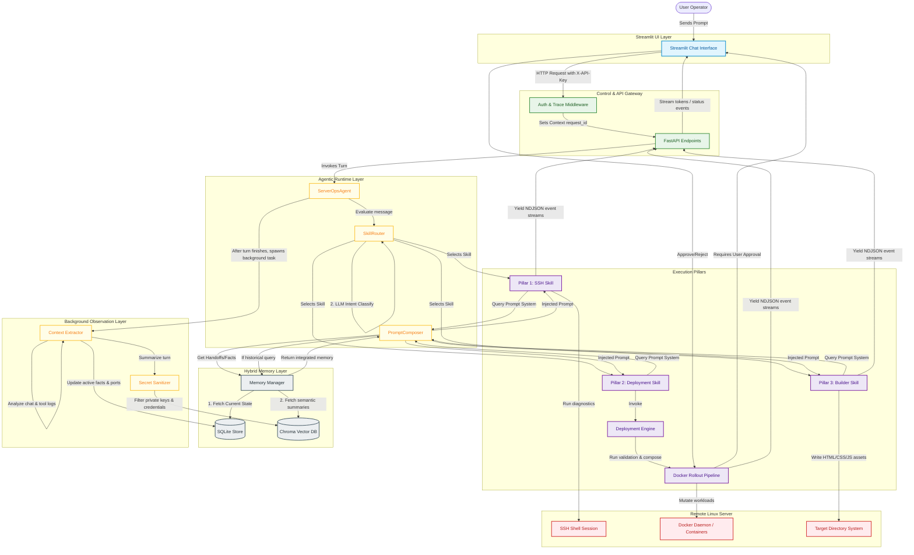

# ShellMate Architectural Flow Diagram

This document contains the high-level architectural flow of the ShellMate project, mapping a user's conversational prompt through the routing, execution, memory, and background extraction pipelines.

## High-Level Flow 

---

## Process Phase Breakdown

### 1. Ingress & Routing
* **API Validation**: FastAPI routes authenticate clients via a shared API key check (`require_api_key`) and generate/assign request tracking IDs (`set_request_id`) for telemetry.
* **Skill Router**: Determines which execution model to trigger. Direct queries bypassing AI logic are captured deterministically via heuristics to guarantee prompt routing to Docker and static site tasks.

### 2. Context Hydration
* **Prompt Composer**: Gathers the context blocks (handoffs, active ports, directory paths).
* **Temporal Detection**: Automatically detects queries referencing "earlier", "yesterday", or "ago" and targets queries at Chroma DB, using date range boundaries.

### 3. Loop Execution
* **Pillar 1 (SSH)**: A dynamic, agentic ReAct loop executing commands on the host via Paramiko.
* **Pillar 2 (Deployment)**: A strict, multi-stage state machine that prevents model improvisation, verifying environment readiness and blocking for approval before modifying containers.
* **Pillar 3 (Builder)**: Conversations dynamically guide the creation of custom web pages, writing assets directly over SSH/SFTP.

### 4. Background Observations
* **Fact Extractor**: Runs silently after the client receives the output, updating SQLite facts (`memory_facts` table) using conflict-safe upsert queries.
* **Vector Archival**: Writes clean execution logs to Chroma DB after stripping SSH keys and passwords, ensuring future prompts can query historical logs safely.
