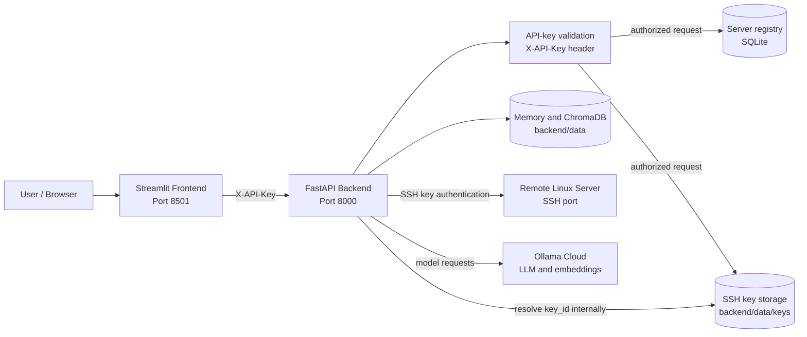
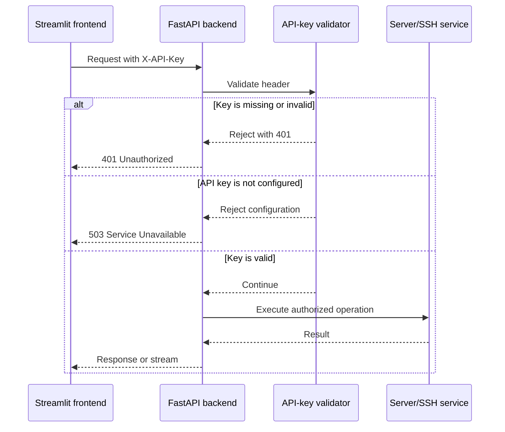
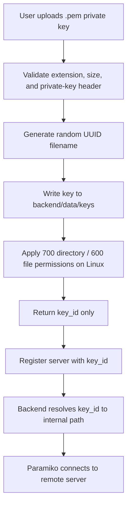
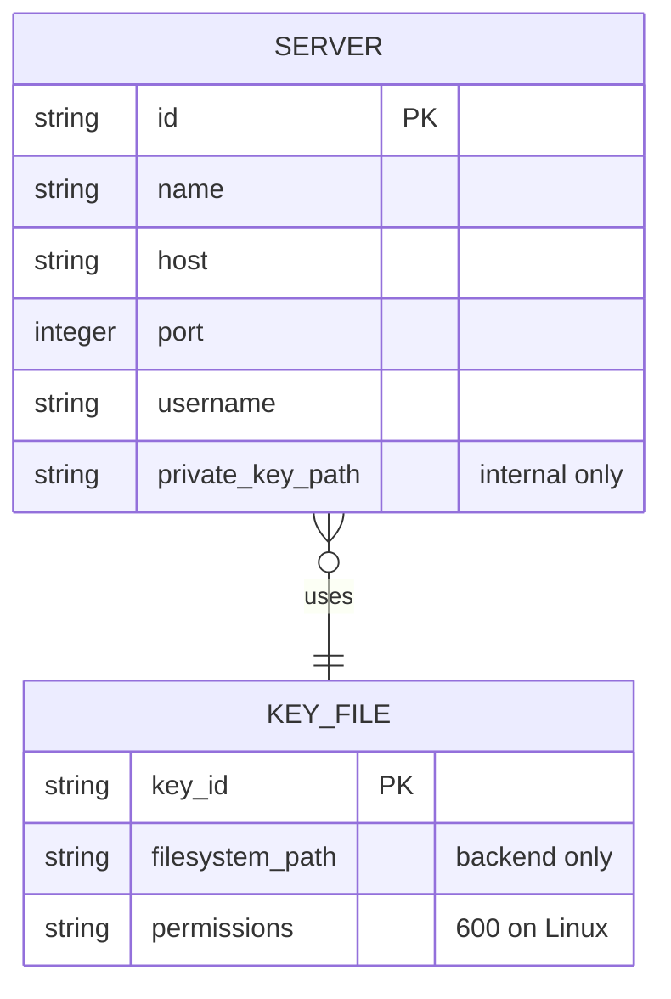
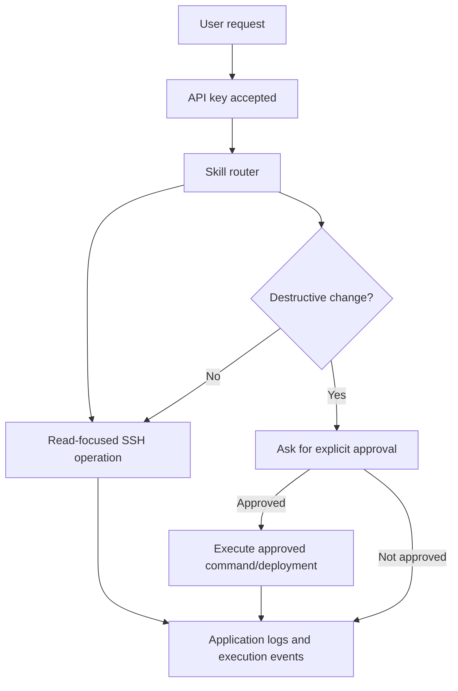

# ShellMate Security Overview

This document describes the current security model of ShellMate. It is a reference for development, deployment, and interviews. It distinguishes implemented protections from future improvements.

## Security goals

ShellMate manages remote Linux servers through SSH, so its main security goals are:

- Prevent unauthenticated clients from invoking server operations.
- Keep SSH private keys outside application metadata and out of API responses.
- Prevent path traversal and arbitrary filesystem paths during key selection.
- Require explicit approval before destructive server operations.
- Preserve SSH keys, databases, and memory across container rebuilds without placing them in images.
- Keep sensitive values out of logs and generated historical memory.

## High-level security boundary



## API authentication

ShellMate currently uses a shared API key rather than JWT. This is appropriate for the current single-user application because the project does not yet have a user, account, refresh-token, or ownership model.



Configuration:

```env
SHELLMATE_API_KEY=long-random-secret
CORS_ALLOWED_ORIGINS=http://localhost:8501
```

The health endpoint remains public so basic availability checks do not require credentials. All other API routers are protected.

## SSH private-key lifecycle

The frontend uploads a key once during server registration. The backend stores the file and returns only an opaque `key_id`. The actual path is used internally by the SSH service.



Implemented key protections:

- Maximum upload size is 64 KB by default.
- Empty files are rejected.
- Files must contain a supported private-key PEM header.
- Stored filenames are random UUIDs and do not preserve the user’s filename.
- Key IDs are checked against path traversal.
- Key files are created exclusively and flushed to disk.
- Linux permissions are restricted to the backend account.
- The actual private-key path is not returned in the public server response.
- Key deletion is blocked while a key is attached to a registered server.
- Key rotation uploads a new key, updates the server association, and then removes the old key.

Key-management endpoints:

```text
POST   /api/v1/keys/upload
DELETE /api/v1/keys/{key_id}
POST   /api/v1/servers/{server_id}/key
```

## Server registration model



The current SQLite schema retains the internal filesystem path for compatibility. The public API exposes `key_id`, not `private_key_path`. A later migration can rename the database column to `key_id` and resolve it at the service boundary.

## Request and command safety



The agent is instructed to prefer read-only commands and require explicit confirmation for install, upgrade, removal, service restart, or other change-making operations.

## Docker security and persistence

```mermaid
flowchart LR
    Image[Docker image]
    Ignore[.dockerignore]
    Env[.env / environment variables]
    Data[Host-mounted backend/data]
    Logs[Host-mounted logs]
    Backend[Backend container]

    Ignore -. excludes .env, keys, databases, logs .-> Image
    Env --> Backend
    Data --> Backend
    Logs --> Backend
    Image --> Backend
```

Important behavior:

- `.env` is not copied into the image.
- SSH keys, SQLite databases, ChromaDB, and logs are persisted through Compose mounts.
- Rebuilding an image does not remove registered servers or keys.
- Removing the host-mounted data intentionally deletes persisted application data.
- Ollama Cloud credentials are supplied through environment variables.

## CORS

CORS is restricted through `CORS_ALLOWED_ORIGINS` and defaults to the local Streamlit origin:

```text
http://localhost:8501
```

Production deployments should set this to the exact frontend origin and avoid wildcard origins.

## Current limitations

The following protections are not implemented yet:

- There is no user login or multi-user ownership model.
- The API key is shared by the application rather than scoped to individual users.
- Keys are protected by filesystem permissions but are not encrypted at rest.
- A host-mounted key directory is not equivalent to a managed secret vault.
- SSH host-key verification currently uses Paramiko’s permissive policy and should be tightened for high-trust deployments.
- There is no complete security audit trail with user identity because user identity is not yet modeled.
- Rate limiting and brute-force protection are not implemented.

For cloud deployment, the next practical improvement is to move private keys to Azure Key Vault and store only a secret identifier in the application database.

## Interview explanation

> ShellMate uses API-key authentication as an intermediate security layer because the current system is single-user and does not yet have an account or ownership model. SSH private keys are uploaded once, validated, stored separately from server metadata, assigned opaque key IDs, and resolved internally only when Paramiko opens a connection. The API never exposes the filesystem path publicly. Key deletion is prevented while a key is attached to a server, and key rotation replaces the active key before removing the old one. For a cloud deployment, I would move the private keys to Azure Key Vault and replace the shared API key with user-scoped JWT authentication and authorization.

